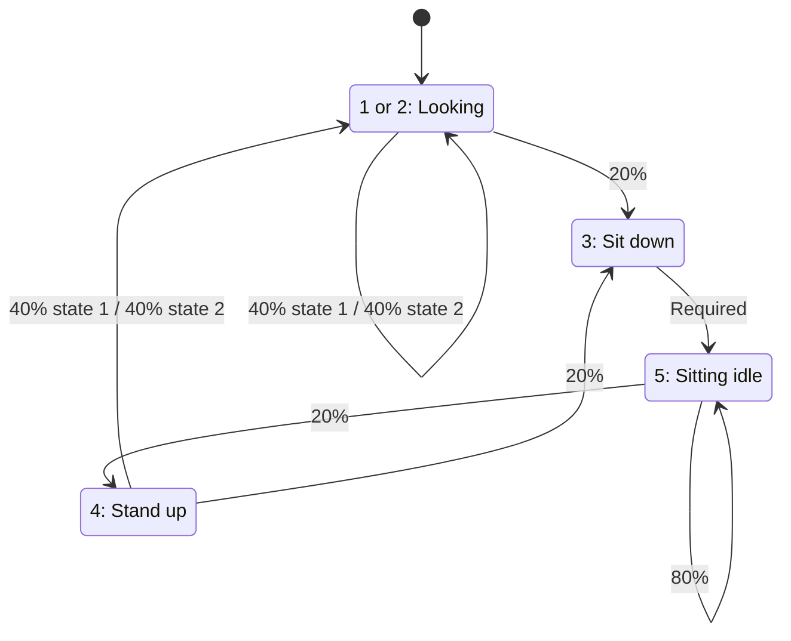

# macOS desktop pet — backend and sprite controller handoff

> Release planning update (November 19, 2026): [SOMBRERO_V1_PLAN.md](SOMBRERO_V1_PLAN.md) is authoritative for the first sombrero release, including the visually reviewed numbered-lettered diagram, two-laptop Python messaging, camera, and Bible reader. The material below records the implemented five-state prototype and its earlier scope; its exclusions and random weights do not constrain the new release plan. The new features are planned, not implemented.

Updated November 18, 2026.

**Implementation resumed at the user’s request.** The first source table, including sitting idle (5), is authoritative. The five-state controller, imported transparent frames, native renderer, resource fallback, and app bundle are implemented. See PROJECT_PLAN.md for the current build and validation record.

## Global font update

Matcha Style is the shared app font. Its OTF and supplied notices are bundled under `Sources/PetAssets/Resources/Fonts/`; `AppTypography` registers it for the process at startup, provides body/menu fonts, and supplies a system-font fallback. Current menus/submenus use it; future bubble, polaroid, rich-text, and Bible-reader controls must use the same typography. See [SOMBRERO_V1_PLAN.md](SOMBRERO_V1_PLAN.md#global-typography).

## Latest direction

The user is generating artwork in Runway. Pause further art generation and focus on the macOS application/backend. Initially placeholder squares were requested; the newest request replaces those placeholders with five local sprite sheets.

Target **macOS only**. Use native Swift/AppKit rather than the earlier Electron proposal. Keep the animation/behavior controller separate from native windows and rendering. No LLM is part of the app. Geographic location, two-computer messaging, automatic updates, and BeReal detection are future scopes, not current integrations to activate.

The user wants a pet above other application windows, with a persistent control icon to restore it if it disappears and accommodate future options. Implement the standard **menu bar status item near Control Center**. Do not claim this is a custom module inside Apple's Control Center. A non-activating panel should leave the current application's keyboard focus alone.

sprite source `assets/duck/v2`

| State | Source file | Dimensions | Role |
| --- | --- | --- | --- |
| 1 | `1-look.png` | 4800 × 3584 | Default looking/idle animation |
| 2 | `2-look.png` | 4800 × 3584 | Alternate looking/idle animation |
| 3 | `3-sitdown.png` | 4800 × 3584 | Sit down; must be followed by state 5 |
| 4 | `4-standup.png` | 4800 × 3584 | Stand up; only selected as the follow-up to state 3 or 5 |
| 5 | `5-sitting.png` | 4800 × 3584 | sitting idle; 80% chance of looping into itself and 20% chance of going into state 4|

All five sheets have now been inspected. They are opaque 4800 × 3584 RGB images. Drawing counts by row: state 1 = 6/6/6/5 (23 drawings, last cell blank); state 2 = 5/6/7/7 (25 drawings, irregular spacing); states 3–5 = 5/5/5/5 (20 drawings each). Read left to right, then top to bottom. The importer records actual crop rectangles, transparent-backdrop extraction, and shared registration; do not apply a uniform 6 × 4 grid.

## Timing — 6 drawings/second, on fours

The newest user instruction supersedes remaining 12 fps language in older project documents:

- Current playback holds each source drawing for **four frames on a 24 fps timeline**, superseding the original on-threes convention at the user’s request.
- Effective drawing cadence is **6 fps**: one drawing every **1/6 second**.
- A 24-drawing sheet therefore takes **4 seconds** to play once. Do not stretch/reinterpret that as a 12 fps or 24 fps drawing sequence.
- Either drive a 24 fps timeline with `durationFrames = 4`, or an 6 fps drawing clock with one tick per drawing. Record both playback convention and effective drawing rate in the manifest so the distinction is explicit.
- Use elapsed monotonic time, not accumulated rounded sleeps. Separate window dragging/display updates from drawing cadence.
- No interpolation or optical-flow frames; preserve the stepped on-fours look.

Suggested manifest fields: `timelineFPS: 24`, `drawingFPS: 6`, `holdFrames: 4`, `columns: 6`, `rows: 4`, actual frame count/order, cell size, shared foot anchor, and resource path. Grid values remain subject to inspecting every sheet.

## Random finite-state controller

Start in **state 1**, at its first drawing. Make automatic decisions at **clip completion**, not every render tick or every frame.

| Current completed state | Next state | Probability |
| --- | --- | --- |
| 1, 2, or 4 | 1 | 40% |
| 1, 2, or 4 | 2 | 40% |
| 1, 2, or 4 | 3 | 20% |
| 3 | 5 | 100% |
| 5 | 5 | 80% |
| 5 | 4 | 20% |

Apply the standing weighted choice after 1, 2, or 4. State 3 must enter state 5, without RNG. After each complete sitting-idle clip, choose 5 at 80% or 4 at 20%. State 4 is never selected directly from standing.

Implementation rules for the next task:

1. Represent states with a typed enum and isolate selection in a pure controller, independent of AppKit.
2. Inject a random-number source for deterministic tests. For example, integer samples 0–39 select state 1, 40–79 state 2, and 80–99 state 3.
3. State 3 must select state 5 directly without consuming a random sample; state 5 loops at 80% or enters state 4 at 20%.
4. Play the current clip once; let its completion select the next clip, including selecting state 1 again. Do not let an internal unconditional renderer loop swallow the completion event.
5. Pause freezes the current drawing/clip clock. Resume must not fast-forward missed wall time. Hide/quit remain immediately responsive; automatic choices cannot interrupt a sit/stand pair mid-clip.
6. Handle missing/corrupt resources with a visible square fallback and working menu bar recovery, not a crash or an invisible input-blocking window.

## Implemented native app

The accessibility setter is fixed. scripts/build-macos.sh compiles and ad-hoc-signs build/WatercolorDuck.app, including the SwiftPM resource bundle. PetCore/SpritePlayback.swift contains the pure controller and clocks; PetAssets/SpriteLibrary.swift validates resources and masks; DesktopPet renders full frames and retains native recovery controls. Originals remain unchanged.

scripts/test-macos.sh passes 14 checks using the same synchronous methods as the XCTest suite, via lightweight assertions. The CLT installation lacks XCTest and the full Xcode XCTest interface is incompatible with the CLT compiler. No license was accepted. The original PetBehavior remains for legacy tests/preferences; the active sprite controller is DuckController, not the old petting placeholder logic.

The app has been launched with real sprite rendering, and its context recovery menu inspected. Broad Spaces/fullscreen/Stage Manager, sleep/wake, display unplugging, and native input/focus smoke tests remain pending. See PROJECT_PLAN.md for source-count corrections and known art drift.

## Native window/control approach

The current source uses `NSPanel` with `.borderless` and `.nonactivatingPanel`, transparent background, `hidesOnDeactivate = false`, non-key/non-main overrides, and `.statusBar` level when Always on Top is enabled. Collection behavior includes `.canJoinAllSpaces` when selected, `.fullScreenAuxiliary`, `.stationary`, and `.ignoresCycle`.

This is intended to appear over normal application windows and participate across Spaces/fullscreen where macOS permits. **Do not promise to appear over the lock screen, protected dialogs, or every system presentation mode.** Test Spaces, fullscreen apps, Stage Manager, and switching applications before declaring the behavior correct. This is a native analogue of a small floating companion, not a claim about ChatGPT's private implementation.

An `NSStatusItem` menu is intended to provide:

- Show / Hide Pet.
- Bring Back to This Screen (also clears click-through to recover interaction).
- Always on Top and Show on All Desktops toggles.
- Click Through Pet and Pause Motion.
- Small/Medium/Large size.
- Quit.

The renderer draws transparent imported full frames; a colored square remains only as a resource-error fallback. Pointer routing checks its interactive area and toggles the panel's mouse-event ignoring for empty regions. Keep a recoverable menu item throughout sprite integration. Clicking versus dragging currently uses a movement threshold. Sprite rendering and slicing are separate from behavior selection.

## Future scopes to retain, not implement now

| Feature | Proposed direction | Important boundary / unresolved choice |
| --- | --- | --- |
| Update target Mac after git push | Push → macOS CI build/test → Developer ID signing/notarization → signed update archive + Sparkle appcast → installed app updates | App should download a signed release, not execute `git pull` or build arbitrary repository code. Repository, CI secrets, signing identity, host, update policy, and distribution setup are not configured. |
| Two-computer geographic location | Explicitly paired devices, Core Location with per-device opt-in, freshest fix + timestamp + accuracy, coarse updates | Screen placement is not geographic location. No location collection, permission prompt, credentials, or sharing is enabled now. Mac accuracy can be insufficient for a tight proximity threshold; stale/uncertain fixes should produce unknown rather than a false nearby result. |
| Special interaction when nearby | A proximity service derives near/far/unknown from both fixes with accuracy bounds, expiry, hysteresis, and cooldown; emits one behavior event | Local peer discovery can be an additional nearby-network signal, not proof of physical distance. No public map or continuous location history is required. |
| Messages between the two Macs | Separate pairing/transport service and durable message IDs; a received event requests a bubble/animation from the local behavior controller | CloudKit is a native option; same-account private data and different-account sharing need different designs. A small authenticated relay is another option if realtime delivery is required. No transport or backend has been chosen/configured. |
| Know when BeReal goes off | Keep a `BeRealEventSource` boundary and a manual/test event first; research a supported source for the relevant timezone | BeReal's official help describes the daily notification but a supported public schedule/notification API has not been verified. Do not promise arbitrary access to another app's notifications or silently rely on undocumented credentials/endpoints. |

Keep these services out of the renderer so future events can trigger the same local finite-state/interaction controller. No LLM is needed for messaging or scripted bubble display.

## Remaining verification

1. Complete manual topmost/focus, alpha pass-through, drag/recover, hide/show, Spaces/fullscreen, display-unplug, sleep/wake, and relaunch-placement checks on the target Mac.
2. Review imported motion, source proportion drift, and transition seams with the user before any new artwork.
3. Do not implement update distribution, pairing, tracking, message transport, or BeReal integration in this step.

## Official references checked

- [Apple: non-activating panels](https://developer.apple.com/documentation/appkit/nswindow/stylemask-swift.struct/nonactivatingpanel)
- [Apple: window levels](https://developer.apple.com/documentation/appkit/nswindow/level-swift.struct)
- [Apple: fullScreenAuxiliary](https://developer.apple.com/documentation/appkit/nswindow/collectionbehavior-swift.struct/fullscreenauxiliary)
- [Apple: NSStatusItem](https://developer.apple.com/documentation/appkit/nsstatusitem)
- [Apple: location authorization](https://developer.apple.com/documentation/corelocation/requesting-authorization-to-use-location-services)
- [Apple: Multipeer Connectivity](https://developer.apple.com/documentation/multipeerconnectivity)
- [Sparkle: publishing an update](https://sparkle-project.org/documentation/publishing/)
- [BeReal: daily notification](https://help.bereal.com/hc/en-us/articles/15416869159197--Time-to-BeReal-Notification)
