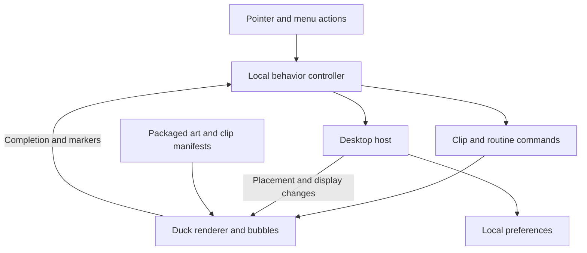

# Watercolor duck desktop pet — animation and application plan

Status: individually drawn idle/pet video preview ready for user review; layered animation method cancelled. No desktop application code has been created.
Updated: November 18, 2026 (America/New_York).

## 1. Product scope

A small independent desktop companion resembling the approved blackboard duck, rendered in imperfect golden watercolor. It idles, responds to petting, reads, gestures while a chat bubble appears, flies away and returns with a polaroid, makes a shooing gesture, and peeks around the screen edge.

**There is no LLM, conversational AI, remote backend, account, or external integration.** Talking means a character gesture accompanied by optional locally scripted text; its mouth does not move. The polaroid is an illustrated animation prop with a fixed placeholder picture. Photo import, camera access, screenshots, and photo services are outside this plan.

Working platform assumption: macOS first, with platform boundaries that allow a later Windows version. This is a proposed implementation direction, not a platform requirement supplied by the user. Art and authoring tools are being developed first; no desktop application scaffold exists yet.

## 2. Current animation method — supersedes layered keyframes

The user cancelled the layered/cutout/keyframe method. **Draw complete individual character frames** and assemble them at exactly **12 fps**. Do not animate a body-parts rig, warp a standing image into poses, or interpolate a few rendered key poses.

The available generation tool produces still images, not video. For this first preview, each artist draws one ordered 24-cell board, four columns by six rows, containing complete sequential duck drawings. Technical slicing, uniform scaling, whole-frame registration, and assembly prepare those drawings for playback. Watercolor is baked into the drawings in that same generation pass; a separate texture overlay remains optional if useful later. No measured cost saving is assumed.

This tool does not enforce temporal consistency: faces, proportions, paint, scale, and motion ordering need visual inspection. Different files are not evidence of smooth animation. Report any visible shape or texture drift.

## 3. Character reference and movement

Authoritative appearance: `generated_images/exec-0f994ff1-3130-4298-b10e-bbb99ffb5446.png`, version `duck-v1-nostrils`, neutral pose 01. The fixed reference hash remains in [character-reference.json](character-reference.json).

Preserve the tall domed head, distinctive broad closed bill with its central raised point, two nostril strokes, sparse eyes, small oval torso, angular wings, and thin legs. Retain uneven golden watercolor; do not add paper texture.

Acting must be **very noodly**: flowing arcs, soft body bends, supple wing movement, elastic anticipation, overshoot, and follow-through. Preserve the recognizable head/bill/body relationship through that motion. The current [ARTIST_BRIEF.md](ARTIST_BRIEF.md) is the production authority.

## 4. Current scope: idle and petting, then user video review

| Clip | Acting | Initial preview |
| --- | --- | --- |
| Idle | Breathing/sway, blink closed then open, wing follow-through, loop back toward neutral | 24 complete drawings, 2 seconds at 12 fps |
| Petting | Neutral → anticipate pet → noodly lean toward invisible hand → content closed eyes and wing wiggle → settle → neutral | 24 complete drawings, 2 seconds at 12 fps |

Create a combined video showing each action for two cycles, approximately eight seconds. The user must see that video and explicitly ask to continue before shoo or peeking production begins. Sitting, reading, talking, flight, and polaroid assets are also outside the current production batch. They remain future product ideas, not actions to complete automatically now.

## 5. Artist coordination and review

- Idle artist and pet artist receive the same actual nostril-bearing reference. Each produces complete drawings; they do not depend on a shared parts rig.
- Root reviews each board for character identity, number/order of cells, usable poses, and alpha before technical export.
- Integrator slices/validates complete frames and assembles a 12 fps MP4. No cutout animation, tweening, or shape morphing is added.
- Current output root: `assets/duck/frame-by-frame/v1/`.
- Older source master, frames, atlases, and previews under `assets/duck/v1/` are preserved as superseded experiments and excluded from the current deliverable.
- Earlier detailed layered-method documents are in `docs/archive/`. Do not apply their production method to new art.

## 6. Frame and playback contract

- Standard output: 512 × 512 untrimmed RGBA PNG, transparent backdrop, consistent standing baseline near `(256,448)`.
- Record original source-cell size; technical enlargement is not additional source detail.
- Every clip declares `animationMethod: "individually-drawn-frames"` and `frameRate: { "numerator": 12, "denominator": 1 }`.
- Each frame has a positive integer `durationFrames`; the first preview uses one tick per distinct drawing. Derive timing from the rational rate, not rounded 83 ms delays.
- Track reference hash, generated board path/hash, drawing order, registration offsets, frame files, loop compatibility, and known quality limits.
- Inspect alpha over light and dark backgrounds. Hidden RGB in zero-alpha pixels must not be mistaken for an opaque backdrop.
- Verify 24 nonempty, unclipped frames per clip and report exact duplicates. Check head/bill/nostrils, pigment drift, ground jitter, loop seam, and idle-to-pet scale continuity visually.
- MP4 is the primary review artifact; confirm its real stream rate is `12/1`. Optional offline HTML playback follows the same exact timing.
- Atlas packing is optional after preview review; do not delay the requested video for a production atlas.

## 7. Desktop application and local backend

### Proposed stack

**Electron + TypeScript for the desktop shell and local behavior services; PixiJS for character playback; HTML/CSS for bubbles and controls.** Keep the behavior engine independent of Electron so it can be exercised in isolation or reused in another shell.

This recommendation favors straightforward transparent-window prototyping and a shared language for animation manifests, UI, and behavior. It is a project design judgment, not a claim that Electron is the lightest desktop option. Electron documents window customization and click-through control [S1, S2]; PixiJS documents scene transforms, masking, sprite objects, and asset loading [S4, S5].

| Shell option | Fit | Tradeoff / decision |
| --- | --- | --- |
| Electron + TypeScript | Direct control of desktop window behavior with a consistent browser renderer | Larger baseline app footprint; recommended first implementation, subject to the platform spike |
| Tauri + Rust + web renderer | Worth considering if packaged size and baseline footprint become primary requirements | Adds Rust/native integration and platform webview differences; do not migrate merely on an assumed memory saving |
| Native macOS AppKit + SpriteKit | Strong candidate if this becomes strictly macOS-only with a hard low-overhead target | Separate native implementation and a different portability path; reconsider early if Electron fails the measured budget |

Pin supported stable dependency versions at implementation time after checking their current documentation. No framework dependencies have been installed yet.

### Component ownership

| Component | Responsibility | Must not own |
| --- | --- | --- |
| Desktop host / main process | Window placement, display geometry, tray menu, lifecycle, persistence, validated IPC | Character pixels or frame-by-frame art decisions |
| Behavior controller | Current action, idle scheduling, action priority, composite routines, cancellation | Drawing or direct filesystem access |
| Renderer | Monotonic animation clock, atlas playback, bubbles, masks, input geometry | OS operations or persistent storage |
| Preload bridge | Narrow typed requests/events between renderer and host | Arbitrary filesystem, shell, or raw IPC exposure |
| Asset loader | Resolve validated clip manifests; preload and unload bundles | Selecting autonomous behavior |
| Preferences store | Versioned settings and last safe placement | Per-frame positions or transient animation state |

This is a local process architecture. There is no HTTP server, hosted API, API key, or network request in the feature path.

### Window and screen behavior

Use a small, frameless transparent pet window and an on-demand controls/settings surface. Default the companion window to non-activating behavior where the platform supports it; a pet click should not steal keyboard focus from the user's work. Activate a controls surface only when requested. Include a tray/menu restore command from the first prototype.

Keep the pet window tightly bounded around the current animation envelope rather than creating a full-screen transparent window. When resizing for a bubble or prop, compensate the window origin so the duck's screen-space pivot does not jump. Precompute the envelope for a clip or transition rather than resizing to every individual frame.

**Transparent pixels do not automatically make an Electron window click-through.** Explicitly enable ignoring mouse events when the cursor lies outside interactive duck/UI geometry, and disable it when interaction is needed. On macOS/Windows, forwarded mouse-move events can assist re-entry [S1]. Use a conservative, precomputed duck hit mask and padding, not a GPU pixel readback each frame. Recompute cursor-to-pet mapping during moving clips even if the pointer is stationary. Keep interaction capture while dragging or petting until pointer-up/cancel. Prove this works in the platform spike before choosing the final hit-testing implementation.

Use Electron `screen` display information in device-independent coordinates; convert rendering resolution separately [S3]. Save display ID plus normalized work-area placement and clamp restored positions to a currently attached display. Handle displays with negative origins, mixed density, menu bars/docks, changing work areas, display removal, sleep/wake, and app relaunch. Test full-screen apps and Spaces explicitly rather than assuming an always-on-top window behaves identically everywhere.

During flight, one controller owns root travel. The renderer owns flap timing. Commands share a routine token and a monotonic start time; the host owns native window movement. Freeze/finish native movement before enabling drag. Do not let independent timers compete to position the same duck.

### Behavior model

Maintain one foreground action and a small queue of explicit user requests. Idle selection is an internal timer with seeded randomness for testing. It selects among standing, sitting, and looking only when no foreground action is active. Reading can be entered by an explicit command initially; autonomous reading can be added later as a configurable behavior.

Lifecycle state is separate from pose: `visible`, `offstage`, `hidden`, `suspended`. A hidden duck is not continuously running an offscreen flight loop. Keep temporary action state in memory and persist only preferences and safe placement.

Priority, high to low:

1. Quit, dismiss, suspend, display loss: cancel current work and stop native movement immediately.
2. Active drag: owns placement until release; restores a safe grounded pose.
3. Direct interaction such as petting or a menu action: enter at the current clip's safe interruption marker; don't rip a book/photo out of a wing mid-frame.
4. Finite routines such as polaroid, read entry/exit, shoo, and peek.
5. Idle selection.

The user can always dismiss or quit without waiting for an artistic transition. Other interruptions either follow an authored recovery path or return directly to a known neutral frame if an asset is missing. On interrupted flight, cancel travel, clamp to a safe visible location, land if compatible, then continue; never restore an arbitrary offscreen position.

Every command carries `requestId` and a new `actionToken`. Renderer marker/completion messages must echo that token; stale completions are ignored. A watchdog based on each finite clip's declared duration prevents a missing completion from trapping the state machine. Looping clips end only on an explicit exit command. Cancel a polaroid routine atomically so its delayed return cannot resurrect the duck after dismissal.

### IPC contract to implement

| Direction | Message | Payload / behavior |
| --- | --- | --- |
| Renderer → host | `interaction.request` | Validated pet, drag, read, scripted-talk, shoo, polaroid, peek, or dismiss action; finite coordinates where relevant |
| Renderer → host | `animation.ready` | Action token and successful asset preload; host may begin synchronized travel |
| Renderer → host | `animation.marker` / `animation.complete` | Action token and allowlisted clip marker; backend validates expected current action |
| Renderer → host | `preferences.update` | Allowlisted settings fields; not an arbitrary file path |
| Host → renderer | `action.play` / `action.cancel` | Token, clip ID, monotonic start time, allowed parameters, and next-state cue |
| Host → renderer | `viewport.changed` | Display/work-area geometry, scale, root placement, optional edge mask |
| Host → renderer | `bubble.show` / `bubble.hide` | Local string ID or plain text, duration, attachment; no HTML injection |

Use context isolation, sandboxed renderer, no renderer Node integration, packaged local UI, sender validation, and a small explicit preload API [S6]. Renderer input is data, not executable code. The app needs no shell commands, screen capture, accessibility automation, or remote content to implement the requested feature set.

### Persistence

Start with one schema-versioned JSON preferences file under the application's user-data directory. SQLite is unnecessary for these settings and there is no chat history.

Fields: character asset version; scale; preferred display and normalized safe position; always-on-top choice; idle intensity; reading/peek enable flags if autonomous modes are later introduced; reduced-motion mode; local bubble preference; launch-at-login preference, initially off.

Only the host writes the file. Debounce preference changes; write a temporary file in the same directory and atomically replace the old one. Validate values on load, migrate known schema versions, and recover defaults on malformed content while retaining a backup for diagnosis. Save after drag release, not on every movement tick. Restore to a neutral visible pose unless the user preference explicitly keeps the pet hidden. Never persist a halfway-complete fly-away routine.

### Resource use and motion comfort

- Target display-cadence smooth root travel during short flights, with character animation authored and played at exactly 12 fps. Idle holds should stop continuous rendering and schedule the next actual change.
- Stop hidden/offstage drawing, pause idle scheduling during sleep/lock, and resume with a fresh monotonic timeline rather than playing missed frames.
- Set an initial idle CPU target below 1% on the developer's Mac over a five-minute idle run. Record hardware and measurement method; it is a test target, not a guarantee.
- Measure full-app resident memory including child processes separately from the 64 MiB decoded character texture target. Record the baseline in the first platform spike; if that footprint is unacceptable, revisit the shell before producing the full application.
- Reduced motion substitutes short holds and simple entrances for flights and large peeks; the same actions still complete without animated travel.

## 8. Next steps and review gate

1. Finish individually drawn idle/pet boards and technical frame export.
2. Validate identity, alpha, frame order, exact12fps timing, and known temporal drift.
3. Present the combined MP4 to the user.
4. Wait for the user to review and explicitly continue before shoo or peeking.
5. After art direction is accepted, implement the previously planned local desktop shell and behavior controller.

No LLM or external integration is part of the application. A polaroid remains an illustrated future prop only.

## 9. Superseded experiments

A shared cutout master and transformed animation pilot were created before the user cancelled that approach. They are preserved under `assets/duck/v1/` for history only and do not count as the new individually drawn preview. Archived layered-method specifications are under `docs/archive/`.

## 10. Official implementation references

Checked November 18, 2026 (America/New_York). These references support API capabilities; the architecture, thresholds, and artistic recommendations above are project proposals.

- [S1 — Electron custom window interactions](https://www.electronjs.org/docs/latest/tutorial/custom-window-interactions): explicit mouse-event ignoring, forwarded movement, and conflicts between draggable regions and pointer interaction.
- [S2 — Electron BrowserWindow](https://www.electronjs.org/docs/latest/api/browser-window/): desktop window construction and customization.
- [S3 — Electron screen](https://www.electronjs.org/docs/latest/api/screen/): display geometry, work areas, scale factors, and display change events.
- [S4 — PixiJS scene objects](https://pixijs.com/8.x/guides/components/scene-objects): containers, sprites, transforms, pivots, masks, and draw ordering foundations.
- [S5 — PixiJS assets](https://pixijs.com/8.x/guides/components/assets): loading/caching/unloading textures and JSON spritesheets.
- [S6 — Electron security](https://www.electronjs.org/docs/latest/tutorial/security): isolated renderer and a narrow validated bridge to privileged operations.
