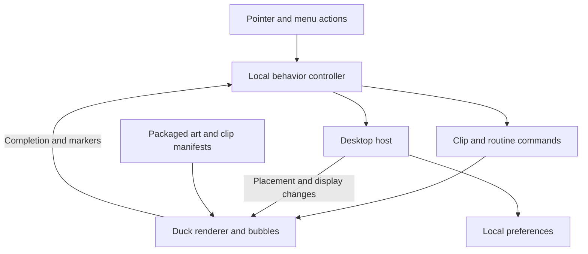

# Watercolor duck desktop pet — animation and application plan

Status: design specification; no production animation assets or application code generated yet.
Updated: November 18, 2026 (America/New_York).

## 1. Product scope

A small independent desktop companion resembling the approved blackboard duck, rendered in imperfect golden watercolor. It idles, responds to petting, reads, gestures while a chat bubble appears, flies away and returns with a polaroid, makes a shooing gesture, and peeks around the screen edge.

**There is no LLM, conversational AI, remote backend, account, or external integration.** Talking means a character gesture accompanied by optional locally scripted text; its mouth does not move. The polaroid is an illustrated animation prop with a fixed placeholder picture. Photo import, camera access, screenshots, and photo services are outside this plan.

Working platform assumption: macOS first, with platform boundaries that allow a later Windows version. This is a proposed implementation direction, not a platform requirement supplied by the user. The current project folder contains three generated reference PNGs and no application scaffold or Git checkout.

## 2. Animation decision

**Author with reusable painted layers plus a few newly drawn poses; ship baked transparent sprite animations.** Move the whole duck across the desktop procedurally. Keep chat bubbles and the polaroid picture area separate from the duck artwork.

This separates three decisions that are easy to confuse:

1. **Source artwork:** layered head, torso, wings, feet, facial marks, and props make revisions and modest pose changes consistent.
2. **Paint appearance:** watercolor pigment belongs to those painted parts. It moves with the duck rather than floating over the screen as a noise overlay.
3. **Playback:** bake the assembled character into registered RGBA frames and texture atlases. The application plays those frames; it does not need a live character rig.

| Approach | Strength | Problem for this duck | Decision |
| --- | --- | --- | --- |
| Independently generate every animation frame | Fast exploration of new poses | Head, bill, nostrils, scale, and paint patterns drift; adjacent images are rarely reliable in-betweens | Avoid for production sequences |
| Generate a whole animation sheet in one pass | Useful rough storyboard | Consistent cell sizes, exact timing, transparency, and continuity still require cleanup | Concept stage only |
| Pure cutout rig with painted parts | Reuses exact face and pigment; cheap iteration | Large rotations, folded wings, sitting, and prop contacts expose seams and look hinged | Use for gentle motion and source preparation |
| Fully drawn frame animation | Strong silhouettes, contact, and natural wing movement | Most labor; artists must maintain paint registration and proportions | Use selectively for large pose changes |
| Hybrid source artwork, baked playback | Stable character, controlled texture, expressive special actions | Requires a master model and a small export pipeline first | Recommended |
| Separate full-screen watercolor filter | Uniform effect across many drawings | Paint slides or boils independently of anatomy; changes bubbles and props too | Do not use |

### Watercolor motion rules

- Preserve uneven pigment density, pooled edges, soft brush boundaries, and irregular dark linework within the character. Background remains transparent.
- Keep the same painted head and bill for nearby poses. Move the head, bill, eyes, and both nostrils as a single face group for small tilts.
- Redraw only where the silhouette or overlap actually changes. Reuse texture patches in local part coordinates where possible.
- Reconstruct hidden artwork behind shoulders and the head when making layers; a flat reference PNG does not already contain these occluded areas.
- Avoid stacking translucent cut edges into dark seams. Source patches need overlap beneath the upper part, while the final visible wash should remain even.
- Default to stable pigment. Optional subtle line variation can use two deliberately authored alternates on occasional holds, never fresh random noise each frame.
- The required acting style is very noodly: loose flowing arcs, soft torso bends, floppy wing movement, elastic anticipation, asymmetric overshoot, and playful follow-through. Use pauses and blinks for contrast while preserving the recognizable head, bill, two nostrils, and overall model proportions.
- Author and play every character clip at exactly **12 fps**. One tick is `1000 / 12` milliseconds; holds last positive integer numbers of ticks. Do not accumulate rounded 83 ms frame intervals. Whole-character desktop travel may update at display cadence independently.
- Do not crossfade large pose changes: two overlapping bills or heads look like ghosts. Use matching transition drawings or a brief shared hold.

### Playback architecture

Use one duck atlas animation at a time. At runtime, independently control root position, orientation, visibility, screen-edge clipping, and UI attachment points. Props requiring wing overlap can be baked with the duck, while the polaroid's picture area uses a separate masked image slot with per-frame transform data. This retains the option to change that placeholder later without creating an integration now.

## 3. Shared character reference

The authoritative reference is the **latest twelve-pose sheet with two nostril lines on every bill**:

`generated_images/exec-0f994ff1-3130-4298-b10e-bbb99ffb5446.png`

Reference ID: `duck-v1-nostrils`. Dimensions: 1217 × 1293 pixels. SHA-256:

`284d1c9d54fd373d19a8b5a7c7ea680f08df5252dc08ed275eda56ef507f4ca1`

Pose 01 defines the neutral front model. Poses 05, 07, and 11 inform sleepy, sitting, and slight three-quarter variants. This sheet is a **visual reference, not a production atlas**: it contains a white backdrop, labels, unequal pose registration, and no animation timing or pivot metadata.

Character invariants:

- Large, tall, softly domed, slightly irregular head; much smaller vertical oval torso.
- Broad low bill with the distinctive central raised point. Preserve its outline and position relative to the eyes. No mouth or lip-sync frames.
- Exactly two short nostril strokes on the bill, visible whenever the bill is visible. Turn and occlusion must be intentional.
- Two small dark dash eyes, small angular wings, short thin legs and feet.
- Warm golden yellow head, deeper ochre torso, pale warm bill, loose dark brown linework.
- No added ears, tail, long canine muzzle, human hands, enlarged torso, or redesigned flight anatomy.

Proportion estimates for planning only: head occupies roughly 60–65% of standing height, torso 25–30%, legs the remaining 10%; head is roughly twice torso width. **The reference drawing wins over these estimates.** Measure and record actual landmarks on the cleaned master before handing work to different artists. Perspective, sitting, and tilt should transform that model rather than independently re-proportion it.

The earlier sixteen-character exploration and the nostril-free pose sheet are superseded. Artists must never substitute one of those because it is easier to find. See [ARTIST_BRIEF.md](ARTIST_BRIEF.md) and [character-reference.json](character-reference.json).

## 4. Animation inventory

Durations and drawing counts below are initial production estimates. They are not deadlines, final frame counts, or requests to generate all frames at once. Quantize durations to whole ticks on the exact 12 fps timeline. Each action has an entrance, any loop/hold, and a safe exit, all with the very noodly movement style.

| Animation family | Acting and sequence | Authoring strategy | Timing target | Completion / cancellation |
| --- | --- | --- | --- | --- |
| Waiting idle | Soft breath, occasional blink, tiny weight shift | Reused neutral parts; 3–5 distinct poses, held | 3–6 s variation; blink every 4–9 s | Loop; leave at a shared neutral pose |
| Sitting idle | Lower into a sit, settle, occasional blink, stand | Draw sit/stand silhouettes; reuse pose 07 proportions; 6–10 distinct poses | 0.5–0.8 s entry; 4–8 s hold variation | Use stand exit before standing actions |
| Looking around | Small left glance, pause, right glance, return | Small head rotations plus slight three-quarter drawing; 4–6 poses | 2–4 s | Return head and eyes to neutral |
| Being petted | Noodly lean toward cursor, close eyes, supple wing response, elastic settle | 5–8 key poses with soft body bends and follow-through, fixed bill | Approximately 0.3 s entry; 0.8–1.4 s loop; 0.3 s exit, quantized to 12 fps ticks | Pointer release ends loop; drag overrides |
| Reading book | Bring book up, read with eye/head motion, occasional page turn, put away | Separate painted book source; drawn wing contacts; 8–12 poses | 0.6 s entry; 3–5 s loop; 0.6 s exit | Close/lower book before standing or petting |
| Talking gesture | Small head nods and wing beats while a scripted bubble appears | 4–6 poses; bill and nostrils remain fixed | 1–3 s gestures with quiet holds | Bubble timer or explicit dismissal; no speech detection |
| Flying away | Crouch anticipation, wing spread, lift, flap, exit view | New silhouette keys; 6–8 launch and 4–6 flap poses; procedural travel | 0.5–0.8 s launch, 0.8–1.5 s departure | Hidden/offstage until return cue |
| Returning with polaroid | Enter flapping with prop, land, settle | Reuse compatible flap keys; new holding/landing contacts; 6–8 poses | 1–2 s travel; 0.4–0.7 s landing | Recover to grounded pose with prop |
| Showing polaroid | Raise photo, present proudly, hold, lower/stow | 4–6 poses; photo behind wing tips; picture slot separate | 0.5 s reveal; 3–5 s hold; 0.5 s lower | Dismissal stows prop and restores neutral |
| Go-away / shoo gesture | Duck makes a small dismissive outward wing flick, then settles | 4–6 poses; recognizable small angular wing | 0.8–1.4 s | Ends at neutral; separate from hiding the app |
| Peeking around edge | Duck slides partly into view, pauses, glances, retreats | 4–6 pose keys plus edge mask and root motion | 0.5–0.8 s entrance; 1–3 s hold | Reverse entrance and return to known position |

Expect roughly 50–80 authored key drawings/part variants and 80–140 unique exported frames after in-betweens and transitions, subject to the pilot. Reuse frames and timing holds instead of making a new bitmap for every display refresh. The polaroid routine is a composite sequence of departure → offstage pause → return → presentation → stow; no photo needs to be fetched while offstage.

### Special behavior clarifications

**Petting versus dragging:** quick click can trigger a short pet reaction; pointer movement across the head with the button held sustains petting. Dragging the torso beyond a small movement threshold moves the duck. Lock that interpretation for the gesture until pointer-up so the duck cannot alternate between pet and drag mid-gesture.

**Go away:** use `gesture.shoo` for the duck's wing gesture and `pet.dismiss` for the user hiding the companion. Dismiss stops routines and hides the pet; a tray/menu command restores it. These are different behaviors even if the UI eventually combines them.

**Peeking:** first version means appearing from a selected display edge, not behind arbitrary application windows. Keep the native window on-screen and use a renderer clip mask to hide the duck behind that edge. Author left/right variants by validated mirroring where possible; preserve the bill's asymmetry deliberately. Test top/bottom compositions before adding them.

**Flight:** “offscreen” is a staged illusion. Fly to a visible screen edge, clip out, mark offstage, then replay a return path. Do not depend on placing a window beyond physical display bounds, where it may appear on a neighboring monitor or be clamped by the OS.

## 5. Production sequence and artist coordination

1. Lock `duck-v1-nostrils` and prepare a clean, high-resolution neutral master. Maintain the current design; do not improve or reinterpret the face.
2. Reconstruct painted source layers, pivots, overlaps, and a small palette sample. A neutral render must visually match pose 01.
3. Produce one small pilot: waiting/blink, head tilt, and one pet reaction. Verify that the bill stays fixed, watercolor stays attached, and alpha edges work over light and dark desktops.
4. Freeze the reusable master, coordinate system, paint/line treatment, reference hash, and export settings as one versioned reference pack. Work cannot fan out before this dependency exists.
5. Assign action families to artist agents using the same brief and actual image paths. Each task receives the full current reference, cleaned neutral master, shared layers, action limits, and a matching entrance/exit pose.
6. Integrate one family's key poses at a time, compare against the master, then animate in-betweens. Review the loop in motion before expanding that family.
7. Export atlases and manifests, validate, and run the complete interaction sequence on the desktop.

Suggested future ownership:

| Owner | Scope | Shared dependency |
| --- | --- | --- |
| Character lead | Master cleanup, head/bill/nostrils, palette, linework, registration, acceptance | Latest nostril sheet |
| Idle artist | Waiting, sitting, looking, petting | Locked master and pilot |
| Prop/gesture artist | Book, talking gesture, shoo, polaroid presentation | Locked master; shared book/photo assets and wing sockets |
| Flight/edge artist | Launch, flap, landing, return, edge peek | Locked master; same scale and travel/attachment rules |
| Integrator | Timing, transitions, prop layering, atlas packing, manifests, desktop QA | All approved action bundles |

Artist agents are production roles for the next stage; none are being asked to independently invent a replacement duck. No production art has been generated as part of this planning stage.

## 6. Asset and playback contract

- Layered source master: preferably 1024 × 1024 working canvas; do not claim that enlarging the current reference adds real detail. Trace/clean or carefully repaint from the reference while preserving the design.
- Standard exported character frame: 512 × 512 RGBA PNG, sRGB, transparent background. Keep all action silhouettes and props inside this canvas. Use a documented expanded-canvas variant only when necessary, with an explicit anchor offset.
- Registration: `(256, 448)` is the standing ground pivot in a standard frame. Plan approximately 360 px standing character height. Do not individually center frames or resize the duck to fill its cell.
- Flight and sitting retain that coordinate system. Their silhouettes move relative to the ground pivot intentionally. Store per-frame attachment metadata using untrimmed canvas coordinates.
- Default desktop character height: approximately 140–180 device-independent pixels, adjustable. Pixel density changes affect rendering resolution, not world position or character proportions.
- Source layers: `head_paint`, `face_marks`, `torso`, `wing_left`, `wing_right`, `leg_left`, `leg_right`; prop sources `book` and `polaroid`. Face marks include bill contour, eyes, and both nostrils. Preserve a combined head group for routine tilts.
- Prop drawing order is explicit: torso → prop/back wing as appropriate → front wing tips. A visible wing must actually touch the book/photo. No floating props.
- Production frames contain no labels, grid lines, white rectangles, paper backdrop, or debug marks. Do not remove white by a naive color threshold: that damages pale paint and the polaroid border.
- Preserve soft alpha and decontaminate any white matte. Validate the actual renderer's alpha convention to avoid double premultiplication and dark fringes.
- Pack lossless PNG atlases, initially no larger than 2048 × 2048, using multiple pages. Add packing padding and edge extrusion, and preserve original frame size and trim offsets. A 2048² uncompressed RGBA page is about 16 MiB before mipmaps and other overhead; compressed file size does not measure GPU memory.
- Preload neutral/idle. Load special-action bundles before transitioning; release unused bundles when safe. Keep an initial decoded character texture budget around 64 MiB and profile rather than assuming it is achieved.
- Use a neutral frame if an optional clip fails to load; never leave an invisible window intercepting input.

Planned action naming: `idle.wait`, `idle.sit.enter`, `idle.sit.loop`, `idle.sit.exit`, `idle.look`, `react.pet.enter`, `react.pet.loop`, `react.pet.exit`, `activity.read.enter`, `activity.read.loop`, `activity.read.exit`, `gesture.talk`, `gesture.shoo`, `flight.launch`, `flight.flap`, `flight.land`, `photo.present`, `photo.hold`, `photo.stow`, `edge.peek.enter`, `edge.peek.hold`, `edge.peek.exit`. Composite routine ID: `routine.polaroid`.

A future clip manifest contains: schema version, character/reference version, clip ID, source canvas size, atlas/frame IDs, `frameRate: { "numerator": 12, "denominator": 1 }`, positive integer `durationFrames` for each image/hold, loop behavior, ground pivot, per-frame prop/bubble attachment transforms, named timeline markers, safe interruption points, compatible entrance/exit poses, and fallback clip. Millisecond durations are derived from the frame rate, not rounded and accumulated. A future build validator rejects missing frames, non-12-fps clips, invalid frame counts, out-of-bounds metadata, inconsistent reference versions, and unknown marker names. These manifests will be authored with real frames; no fake atlas paths are introduced now.

## 7. Desktop application and local backend

### Proposed stack

**Electron + TypeScript for the desktop shell and local behavior services; PixiJS for character playback; HTML/CSS for bubbles and controls.** Keep the behavior engine independent of Electron so it can be exercised in isolation or reused in another shell.

This recommendation favors straightforward transparent-window prototyping and a shared language for animation manifests, UI, and behavior. It is a project design judgment, not a claim that Electron is the lightest desktop option. Electron documents window customization and click-through control [S1, S2]; PixiJS documents scene transforms, masking, sprite objects, and asset loading [S4, S5].

| Shell option | Fit | Tradeoff / decision |
| --- | --- | --- |
| Electron + TypeScript | Direct control of desktop window behavior with a consistent browser renderer | Larger baseline app footprint; recommended first implementation, subject to the platform spike |
| Tauri + Rust + web renderer | Worth considering if packaged size and baseline footprint become primary requirements | Adds Rust/native integration and platform webview differences; do not migrate merely on an assumed memory saving |
| Native macOS AppKit + SpriteKit | Strong candidate if this becomes strictly macOS-only with a hard low-overhead target | Separate native implementation and a different portability path; reconsider early if Electron fails the measured budget |

Pin supported stable dependency versions at implementation time after checking their current documentation. No framework dependencies have been installed yet.

### Component ownership

| Component | Responsibility | Must not own |
| --- | --- | --- |
| Desktop host / main process | Window placement, display geometry, tray menu, lifecycle, persistence, validated IPC | Character pixels or frame-by-frame art decisions |
| Behavior controller | Current action, idle scheduling, action priority, composite routines, cancellation | Drawing or direct filesystem access |
| Renderer | Monotonic animation clock, atlas playback, bubbles, masks, input geometry | OS operations or persistent storage |
| Preload bridge | Narrow typed requests/events between renderer and host | Arbitrary filesystem, shell, or raw IPC exposure |
| Asset loader | Resolve validated clip manifests; preload and unload bundles | Selecting autonomous behavior |
| Preferences store | Versioned settings and last safe placement | Per-frame positions or transient animation state |

This is a local process architecture. There is no HTTP server, hosted API, API key, or network request in the feature path.

### Window and screen behavior

Use a small, frameless transparent pet window and an on-demand controls/settings surface. Default the companion window to non-activating behavior where the platform supports it; a pet click should not steal keyboard focus from the user's work. Activate a controls surface only when requested. Include a tray/menu restore command from the first prototype.

Keep the pet window tightly bounded around the current animation envelope rather than creating a full-screen transparent window. When resizing for a bubble or prop, compensate the window origin so the duck's screen-space pivot does not jump. Precompute the envelope for a clip or transition rather than resizing to every individual frame.

**Transparent pixels do not automatically make an Electron window click-through.** Explicitly enable ignoring mouse events when the cursor lies outside interactive duck/UI geometry, and disable it when interaction is needed. On macOS/Windows, forwarded mouse-move events can assist re-entry [S1]. Use a conservative, precomputed duck hit mask and padding, not a GPU pixel readback each frame. Recompute cursor-to-pet mapping during moving clips even if the pointer is stationary. Keep interaction capture while dragging or petting until pointer-up/cancel. Prove this works in the platform spike before choosing the final hit-testing implementation.

Use Electron `screen` display information in device-independent coordinates; convert rendering resolution separately [S3]. Save display ID plus normalized work-area placement and clamp restored positions to a currently attached display. Handle displays with negative origins, mixed density, menu bars/docks, changing work areas, display removal, sleep/wake, and app relaunch. Test full-screen apps and Spaces explicitly rather than assuming an always-on-top window behaves identically everywhere.

During flight, one controller owns root travel. The renderer owns flap timing. Commands share a routine token and a monotonic start time; the host owns native window movement. Freeze/finish native movement before enabling drag. Do not let independent timers compete to position the same duck.

### Behavior model

Maintain one foreground action and a small queue of explicit user requests. Idle selection is an internal timer with seeded randomness for testing. It selects among standing, sitting, and looking only when no foreground action is active. Reading can be entered by an explicit command initially; autonomous reading can be added later as a configurable behavior.

Lifecycle state is separate from pose: `visible`, `offstage`, `hidden`, `suspended`. A hidden duck is not continuously running an offscreen flight loop. Keep temporary action state in memory and persist only preferences and safe placement.

Priority, high to low:

1. Quit, dismiss, suspend, display loss: cancel current work and stop native movement immediately.
2. Active drag: owns placement until release; restores a safe grounded pose.
3. Direct interaction such as petting or a menu action: enter at the current clip's safe interruption marker; don't rip a book/photo out of a wing mid-frame.
4. Finite routines such as polaroid, read entry/exit, shoo, and peek.
5. Idle selection.

The user can always dismiss or quit without waiting for an artistic transition. Other interruptions either follow an authored recovery path or return directly to a known neutral frame if an asset is missing. On interrupted flight, cancel travel, clamp to a safe visible location, land if compatible, then continue; never restore an arbitrary offscreen position.

Every command carries `requestId` and a new `actionToken`. Renderer marker/completion messages must echo that token; stale completions are ignored. A watchdog based on each finite clip's declared duration prevents a missing completion from trapping the state machine. Looping clips end only on an explicit exit command. Cancel a polaroid routine atomically so its delayed return cannot resurrect the duck after dismissal.

### IPC contract to implement

| Direction | Message | Payload / behavior |
| --- | --- | --- |
| Renderer → host | `interaction.request` | Validated pet, drag, read, scripted-talk, shoo, polaroid, peek, or dismiss action; finite coordinates where relevant |
| Renderer → host | `animation.ready` | Action token and successful asset preload; host may begin synchronized travel |
| Renderer → host | `animation.marker` / `animation.complete` | Action token and allowlisted clip marker; backend validates expected current action |
| Renderer → host | `preferences.update` | Allowlisted settings fields; not an arbitrary file path |
| Host → renderer | `action.play` / `action.cancel` | Token, clip ID, monotonic start time, allowed parameters, and next-state cue |
| Host → renderer | `viewport.changed` | Display/work-area geometry, scale, root placement, optional edge mask |
| Host → renderer | `bubble.show` / `bubble.hide` | Local string ID or plain text, duration, attachment; no HTML injection |

Use context isolation, sandboxed renderer, no renderer Node integration, packaged local UI, sender validation, and a small explicit preload API [S6]. Renderer input is data, not executable code. The app needs no shell commands, screen capture, accessibility automation, or remote content to implement the requested feature set.

### Persistence

Start with one schema-versioned JSON preferences file under the application's user-data directory. SQLite is unnecessary for these settings and there is no chat history.

Fields: character asset version; scale; preferred display and normalized safe position; always-on-top choice; idle intensity; reading/peek enable flags if autonomous modes are later introduced; reduced-motion mode; local bubble preference; launch-at-login preference, initially off.

Only the host writes the file. Debounce preference changes; write a temporary file in the same directory and atomically replace the old one. Validate values on load, migrate known schema versions, and recover defaults on malformed content while retaining a backup for diagnosis. Save after drag release, not on every movement tick. Restore to a neutral visible pose unless the user preference explicitly keeps the pet hidden. Never persist a halfway-complete fly-away routine.

### Resource use and motion comfort

- Target display-cadence smooth root travel during short flights, with character animation authored and played at exactly 12 fps. Idle holds should stop continuous rendering and schedule the next actual change.
- Stop hidden/offstage drawing, pause idle scheduling during sleep/lock, and resume with a fresh monotonic timeline rather than playing missed frames.
- Set an initial idle CPU target below 1% on the developer's Mac over a five-minute idle run. Record hardware and measurement method; it is a test target, not a guarantee.
- Measure full-app resident memory including child processes separately from the 64 MiB decoded character texture target. Record the baseline in the first platform spike; if that footprint is unacceptable, revisit the shell before producing the full application.
- Reduced motion substitutes short holds and simple entrances for flights and large peeks; the same actions still complete without animated travel.

## 8. Implementation order and acceptance

| Phase | Deliverable | Exit condition |
| --- | --- | --- |
| A — platform spike | Transparent desktop window with a temporary neutral placeholder, pointer pass-through, drag, menu restore, display handling | Invisible areas do not block work; duck remains reachable; measured CPU/memory acceptable |
| B — master and pilot | Clean locked master plus idle/blink/head-tilt/pet pilot | Identity, two nostrils, paint stability, alpha edges, and ground registration pass in motion |
| C — core application | Typed local behavior controller, clip player, preferences, sitting/look/read/talk/shoo | Each action exits safely; talk has no mouth changes; scripted bubble stays attached |
| D — special routines | Flight, fixed polaroid prop presentation, edge peek | Correct clipping/contact; interrupting a routine cannot strand or respawn the duck |
| E — release preparation | Signed macOS build, restart/login settings, resource tuning | Clean-machine launch, recovery, and user controls pass |

Artwork and platform spike can proceed independently only after the reference is fixed; all additional artists depend on the master/pilot gate. No bulk production art should begin before that gate. Git currently cannot run because the local Xcode license has not been accepted. Documentation can be written normally; compiling/signing or Git-based setup may require the developer to resolve that machine prerequisite later.

Meaningful validation to implement:

- State-machine tests with a fake clock: idle cancellation, sitting-to-standing transitions, read exit, pet/drag arbitration, stale completion messages, routine cancellation, and missing-asset fallback.
- Asset validation: dimensions, alpha, reference lock, clip durations, attachment coordinates, trim offsets, transition compatibility, and absence of label/backdrop contamination.
- Human visual review: original head/bill/body proportions; exactly two nostrils; no sliding pigment, ghosting, ground jitter, clipped wings, floating book/photo, or talking mouth animation. Numeric checks alone cannot establish visual identity.
- Desktop smoke tests: underlying app receives clicks through empty pixels; duck and bubble remain clickable; drag does not trigger petting; resize does not shift pivot; unplugging a display recovers placement; hide/restore and sleep/wake work; dismissal during flight prevents delayed return.
- Resource checks after the asset bundle is real: idle CPU, native flight smoothness, total process memory, texture residency, battery behavior, and hidden/suspended rendering.

## 9. Open choices that do not block this plan

The platform assumption, exact idle timing, menu wording, scripted bubble lines, placeholder polaroid illustration, and the personality of the shoo gesture can be adjusted later. None changes the character lock or the hybrid animation pipeline. Cloud services and LLM integration are excluded, not deferred requirements.

## 10. Official implementation references

Checked November 18, 2026 (America/New_York). These references support API capabilities; the architecture, thresholds, and artistic recommendations above are project proposals.

- [S1 — Electron custom window interactions](https://www.electronjs.org/docs/latest/tutorial/custom-window-interactions): explicit mouse-event ignoring, forwarded movement, and conflicts between draggable regions and pointer interaction.
- [S2 — Electron BrowserWindow](https://www.electronjs.org/docs/latest/api/browser-window/): desktop window construction and customization.
- [S3 — Electron screen](https://www.electronjs.org/docs/latest/api/screen/): display geometry, work areas, scale factors, and display change events.
- [S4 — PixiJS scene objects](https://pixijs.com/8.x/guides/components/scene-objects): containers, sprites, transforms, pivots, masks, and draw ordering foundations.
- [S5 — PixiJS assets](https://pixijs.com/8.x/guides/components/assets): loading/caching/unloading textures and JSON spritesheets.
- [S6 — Electron security](https://www.electronjs.org/docs/latest/tutorial/security): isolated renderer and a narrow validated bridge to privileged operations.
